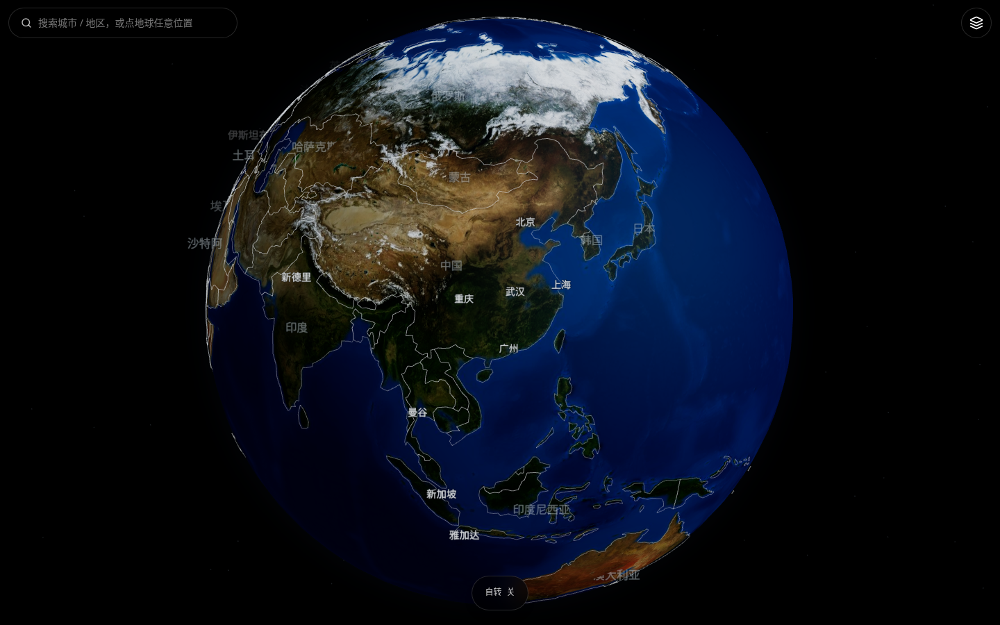
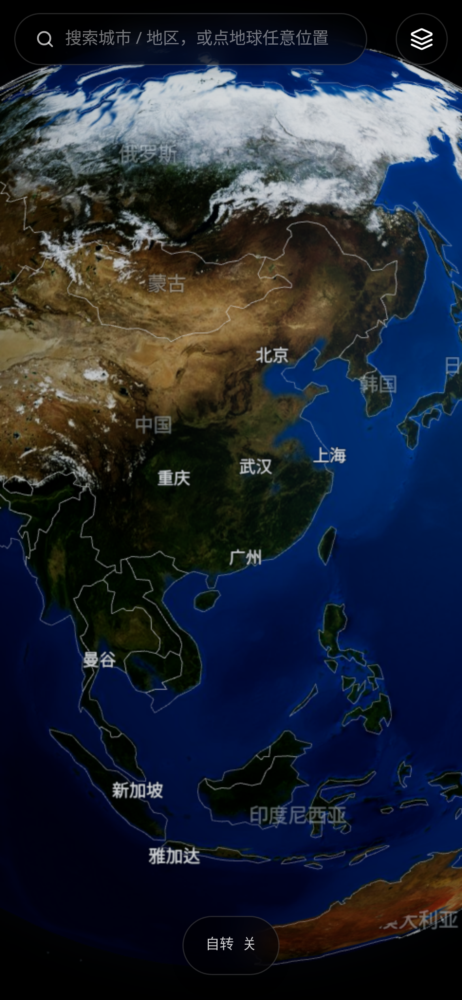
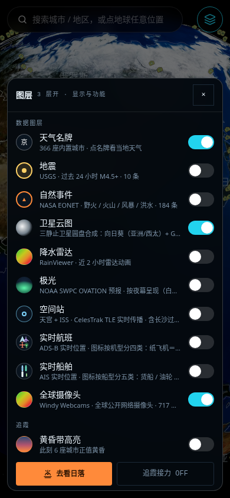
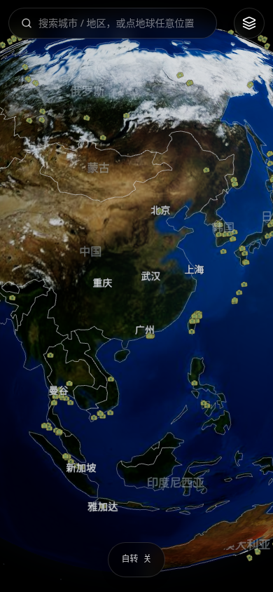

# 地球Online · 全球天气

一个实时 3D 地球仪：把全球天气、卫星云图、降水雷达、航班、船舶、摄像头、空间站、极光等实时数据，全部钉在一颗可以拖动、缩放、点选的地球上。点任意城市名牌或球面任意位置，即可查看当地实时天气；打开图层开关，地球就变成一个全球态势感知台。



| 手机端 | 图层面板 | 摄像头图层 |
| --- | --- | --- |
|  |  |  |

> 截图为应用实际运行界面（2026-11-22 摄于线上版本）。

## 功能列表

- **全球天气**：366 座内置城市 + 全球行政区逐级钻取（省 / 地级市 / 美国州县）+ 点选球面任意位置；实时温度、体感、湿度、风、气压、能见度、PM2.5 / AQI、日出日落与逐小时/逐日预报（Open-Meteo）
- **卫星云图**：向日葵（Himawari）+ GOES-West + GOES-East 三颗静止卫星圆盘按视角加权合成的真彩色/红外云图（NASA GIBS），约 10 分钟更新，另有 RainViewer 全球红外填补
- **降水雷达**：RainViewer 近 2 小时雷达帧动画回放
- **实时航班**：全球 ADS-B 航班位置（约 1500 架），图标按机型分四类并按航向旋转；点开任意航班看详情卡：航路始发/目的地、机型与运营方、该机照片（按注册号精确匹配）
- **实时船舶**：全球 AIS 船舶位置，主源 aisstream.io 全球流（WebSocket 实时订阅主要航区），备源 facha.dev 与芬兰 Digitraffic；图标按船型分五类，详情卡含航速/航向/吃水/目的地/ETA 与本船照片
- **全球摄像头**：Windy Webcams 全球公开网络摄像头（约 700+ 个精选点位），点开即看实时画面（免费档图片链接约 15 分钟过期，服务端按需实时取图）
- **空间站**：国际空间站 + 天宫空间站实时位置（TLE 轨道传播），含指定城市的过境预报
- **极光**：NOAA SWPC OVATION 极光概率预报，按夜幕呈现；天气卡同步显示当地极光可见概率
- **黄昏线与追霞**：真实太阳位置驱动的晨昏线与日落金带；「去看日落」一键飞向此刻正处黄昏的城市
- **地震 / 自然事件**：USGS 过去 24 小时 M4.5+ 地震、NASA EONET 野火/火山/风暴/洪水
- **街景**：点任意位置找附近的 Mapillary 街景照片
- **时光机**：拖动时间滑杆，晨昏线、云图与太阳位置随之穿越 ±12 小时
- **地球此刻**：全球实时极值榜（最热/最冷/风最大/雨最大城市等）
- **全屏与横屏全屏**、地球自转开关、城市收藏

## 快速开始

本项目是为 **Muse Web Artifacts** 平台构建的 TypeScript Space（React 客户端 + 类型化服务端 Actions + SQLite）。推荐的运行方式：

1. 在 Muse 中新建一个 TypeScript 类型的 Web Artifact，将本仓库源码导入其工作区（保持 `client/`、`server/`、`drizzle/` 目录结构不变）。
2. 按 [.env.example](.env.example) 申请并配置三个 API Key（aisstream、Windy Webcams、Mapillary）。**所有 Key 只在服务端使用**：aisstream 的 Key 走 WebSocket 订阅消息、Windy 的 Key 走请求头、Mapillary Token 走 Authorization 头，均不下发前端。不配某个 Key 时，对应图层自动降级（船舶回退免 Key 备源；摄像头/街景显示暂不可用），其余功能不受影响。
3. 由 Muse 平台构建并发布（平台会执行 `package.json` 中的构建脚本并应用 `drizzle/` 数据库迁移）。

本地类型检查（需要 Bun）：

```bash
bun install
bun run typecheck
```

> 说明：`@hatch/space-sdk` 是 Muse 平台的运行时 SDK（见 `package.json`），服务端 Actions、数据库与定时刷新都建立在它之上；脱离 Muse 平台独立部署需要自行提供等价的运行时宿主。

## 技术栈

- **前端**：React 19、three.js（WebGL 地球仪，单次 draw call 的图标点云 + 自定义着色器）、Tailwind CSS 4、TanStack Query
- **服务端**：Bun + TypeScript（严格模式）、类型化 Actions（Zod 校验）、Drizzle ORM + SQLite、satellite.js（TLE 轨道传播）
- **数据管线**：服务端聚合与缓存（天气 5 分钟、船舶流式订阅快照、摄像头区域扫描 30 分钟、城市/航班/船舶照片懒加载入 blob 缓存）

## 数据来源与致谢

| 数据 | 来源 |
| --- | --- |
| 天气与空气质量 | [Open-Meteo](https://open-meteo.com) |
| 卫星云图 | [NASA GIBS](https://www.earthdata.nasa.gov)（Himawari / GOES） |
| 降水雷达、红外云图 | [RainViewer](https://www.rainviewer.com) |
| 航班位置 | [adsb.lol](https://adsb.lol)（OpenSky 备源）；航路/机型 [adsbdb](https://www.adsbdb.com)；飞机照片 [Planespotters](https://www.planespotters.net) / Wikimedia Commons |
| 船舶位置 | [aisstream.io](https://aisstream.io)（主源）；[facha.dev](https://facha.dev)、[Digitraffic](https://www.digitraffic.fi)（芬兰交通基础设施局，备源）；船舶照片 Wikimedia Commons |
| 摄像头 | [Windy Webcams](https://www.windy.com/webcams) |
| 空间站轨道 | [CelesTrak](https://celestrak.org)（[AMSAT](https://www.amsat.org) 镜像备源） |
| 极光预报 | [NOAA SWPC](https://www.swpc.noaa.gov) OVATION |
| 地震 / 自然事件 | [USGS](https://earthquake.usgs.gov)、[NASA EONET](https://eonet.gsfc.nasa.gov) |
| 街景 | [Mapillary](https://www.mapillary.com)（CC BY-SA） |
| 城市照片 | Wikipedia / Wikimedia Commons |
| 地名反查 | BigDataCloud |
| 行政区划边界 | geoBoundaries / Natural Earth |

## 安全说明

- 仓库中**不包含任何真实密钥**：三个 Key 均通过环境变量读取（见 `.env.example`），发布前已做全文扫描确认。
- 所有第三方请求均由服务端发出；前端只调用本项目的类型化 Actions。
- AIS/AIS 类位置数据均经过新鲜度（≤60 分钟）与物理合理性校验后才上图，过期与伪造报告会被过滤。

## 许可证

代码以 MIT 许可证发布。数据、照片与摄像头画面的版权归各自来源所有，使用时请遵守各来源的条款与署名要求（Mapillary 影像为 CC BY-SA；Windy 摄像头需标注来源 Windy）。
